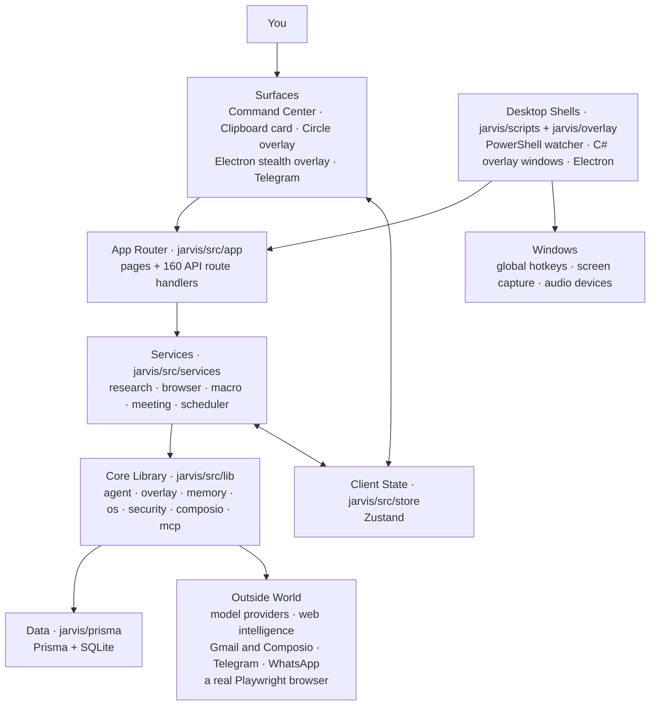
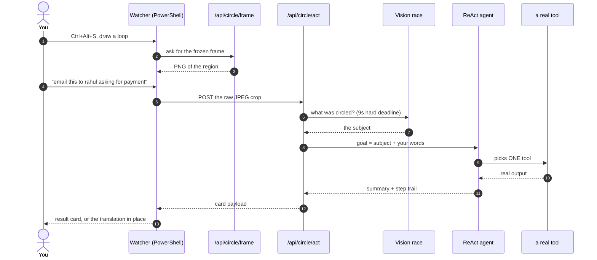

<h1 align="center">J.A.R.V.I.S.</h1>

<p align="center">
  <strong>Point at it. Say the word. It's done.</strong><br/>
  <em>Just A Rather Very Intelligent System</em>
</p>

<p align="center">
  
  
  
  
  
</p>

---

**[The idea](#the-whole-idea)** · **[See it](#see-it)** · **[Three promises](#three-promises)** · **[Architecture](#architecture)** · **[What it can do](#what-it-can-do)** · **[Directory structure](#directory-structure)** · **[Quick start](#quick-start)** · **[Using JARVIS](#using-jarvis)** · **[Verification](#verification)** · **[Environment variables](#environment-variables)** · **[Scripts](#scripts)** · **[Troubleshooting](#troubleshooting)** · **[Tech stack](#tech-stack)**

---

## The whole idea

Most assistants answer the question.

Then you go and do the work.

This one finishes the work.

One keystroke freezes your screen and dims it. You draw a loop around the thing you mean — a paragraph, an invoice, an error, a product, a chart. You say what you want. Out loud, or typed.

Then it happens, while you are still holding the mouse.

There is no action menu. There is no list of supported intents buried somewhere you have to go and discover. The region is *seen* by a vision model. Your sentence becomes the goal. An agent picks a real tool and runs it.

Which means the next capability anyone adds is available from a circle the same afternoon. Nothing was ever hardcoded.

That is the whole product. Everything below is range.

---

## See it

Two keystrokes. Two unrelated tools. No configuration.

```text
    Ctrl+Alt+S          draw a loop around the invoice
    "email this to rahul asking him to pay by the 30th"

    → email.send   ·  composed in context  ·  delivered
      "Sent email to rahul@example.com with the subject 'Invoice 2026-114 Payment Due'."
```

```text
    Ctrl+Alt+S          draw a loop around the French paragraph
    "translate this into Hindi"

    → text.translate  ·  6.7 seconds, end to end
      the Hindi sits over the paragraph you circled. In place. In your app.
```

Neither of those paths was built for the other. There is no branch in the code that says *if the user said "email", do this.* There is a goal, a toolset, and a loop.

---

## Three promises

**It tells you the truth.**

Every card shows the tool that actually ran and the output it actually returned. When it cannot do something, it says so in as many words:

> *"I could not read the text in the circled region (vision timeout). Please press Ctrl+Alt+S, circle a tighter area, and ask me again."*

That is a real answer from this system, on a day when every vision provider was rate-limited. It arrived in nine seconds. The build before it hung for sixty to eighty and handed back an empty card.

Honesty that fast is the feature.

**It can take it back.**

Every side-effecting action — a file move, a write, a send, a clipboard overwrite, a browser navigation — is recorded on an **action tape**, with enough payload to reverse it.

*Undo what you did ten minutes ago* is an operation, not a promise.

**It proves what it claims.**

21 unit suites and four live checks that drive the real gesture, the real routes, and a real email send. The numbers are [at the bottom](#verification), and they fail loudly. Nothing in this document is a guess.

---

## Architecture

One brain. Five ways in.

The same agent runtime that answers a chat message is the one that executes a circled instruction, and the same memory graph feeds both. Desktop features and web features are not a fork — they are two doors into one room.



### Circle to Act, end to end

Every screen-level feature has the same shape: something small on the desktop captures the input, the server does the thinking, and the answer comes back as a card next to your cursor.



### The layers

| Layer | Where it lives | What it owns |
|---|---|---|
| Surfaces | `jarvis/src/components/{hud,panels,reactor,cinematic,widgets,overlay,mcp}` | Command center, HUD rails, the operational panel grid, motion layers |
| App Router | `jarvis/src/app` | Pages and 160 API route handlers — every capability has an HTTP surface |
| Services | `jarvis/src/services` | Research pipelines, Playwright and browser agents, macros, meeting bot, scheduler, LLM chain |
| Core library | `jarvis/src/lib` | The runtime: `agent/`, `overlay/`, `memory/`, `composio/`, `os/`, `security/`, `mcp/`, `persona/` |
| Desktop shells | `jarvis/scripts/*.ps1`, `jarvis/overlay/` | The watcher, the C# overlay window types, the Electron stealth shell |
| Client state | `jarvis/src/store` | Zustand store shared by every panel |
| Data | `jarvis/prisma` | Memory, tasks, reports, reminders, the mail queue, the action tape |

### Three decisions worth knowing

**Screen capture lives on the server, not in the watcher.**

Reading the screen, encoding it, uploading it, owning global hotkeys and watching the clipboard — all inside one PowerShell file — is precisely the shape Windows Defender's AMSI scanner refuses to run. It blocked the watcher outright and took clipboard intelligence down with it. Now the server writes a throwaway capture script per call, and the watcher only asks for a frame and decodes it.

**The result cards cannot take the keyboard. That is the point.**

They are no-activate windows, so they never steal focus from what you are working in. That is also why the natural-language input opens its own small activating ask box. A text field inside a no-activate window could never receive a keystroke, and pretending otherwise would just be a dead button.

**The Electron shell exists for one Windows API.**

`SetWindowDisplayAffinity(WDA_EXCLUDEFROMCAPTURE)` is the only way to keep a window out of a screen share, and Windows refuses the call unless the calling process owns the window. A browser window cannot be excluded. A window we own can. So we own one.

---

## What it can do

Not one feature. A range of them — and they share the same brain.

### Screen — ask, or act

`Ctrl+Alt+S` freezes and dims the screen. You draw a freehand loop. From there, two things:

**Circle to Search** decides what you circled and sends it to the *right* Google surface — a product to Shopping with prices, a place to Maps, a face to Images, a question straight to an answer, a stack trace into code reasoning.

**Circle to Act** takes your sentence and goes to work:

```text
email this to rahul@example.com asking him to pay the invoice by the 30th
translate this into Hindi
remember that this is the laptop I want to buy
find the cheapest place to buy this near me
add this to my cart on amazon
```

The agent chooses among `email.send`, `text.translate`, `memory.save`, `browser.act`, `maps.search`, `maps.directions`, `web.search`, `github` and `whatsapp.send`.

Press `Esc` to abort a search already in flight. Press the hotkey again mid-search to abort and re-freeze for a fresh circle.

> **Why it stays fast.** Vision models are raced in parallel behind a hard nine-second deadline with a 2.5-second hedge. The first valid answer wins; the losers are aborted. A throttled provider can never cost you its own timeout. The old sequential chain — 30 seconds per model, then three more providers — is exactly how a circle once took 60 to 80 seconds and came back empty.

### Clipboard — intelligence before you break flow

`npm run clipboard` watches what you copy, names it, and offers the verbs that actually apply — a card next to your cursor, never a window that steals focus.

It recognises **14 kinds of clip** from the text itself: question, code, error, website, video, repository, content, message, SQL, image, structured data, command, equation, text.

Code gets *Fix · Explain · Optimize · Test*. Errors get *Diagnose*. Links get *Open · Summarize · Research · Extract information*. Content gets *Key points · Analyze · Ask questions*. Questions get *Answer · Explain simply · Exam answer*. Messages get *Reply*.

**Apply on screen** writes the answer back into the app you were working in. **Copy** puts it on the clipboard and suppresses the watcher so it does not re-trigger itself.

### Overlay — a copilot that can be invisible

An Electron shell that floats over everything, and can stay out of a screen share.

Seven modes, one key each: `Alt+1` General · `Alt+2` Meeting · `Alt+3` Interview · `Alt+4` Technical · `Alt+5` Study · `Alt+6` Negotiation · `Alt+7` Presentation.

Then the keyboard does the rest — `Alt+A` answer now, `Alt+S` summarise, `Alt+E` go deeper, `Alt+R` repeat, `Alt+D` change length, `Alt+M` mute, `Alt+P` privacy, `Alt+C` context, `Alt+X` forget everything, `Ctrl+Enter` send, `Esc` hide. `Alt+K` shows every binding.

Underneath: a live transcript, a context brain that decides when to speak up, a queue, and streaming answers.

### Autonomy — a real ReAct loop

The model picks **one** tool per turn. The tool actually runs. The true output is fed back before the next decision. No simulation, no narration of actions it did not take.

| Tool | What it really does |
|---|---|
| `browser.act` | Opens a **visible** browser and works the page — carts, forms, bookings |
| `email.send` | Composes in the right tone and sends from your connected Gmail |
| `web.search` | Live search with a Serper → Brave → Firecrawl fallback chain |
| `maps.search` · `maps.directions` | Real places and real routes, anchored to your live location |
| `github` | Live GitHub REST — repos, issues, pulls, commits, contents |
| `whatsapp.send` | A real message to a named contact through the bridge |
| `text.translate` · `memory.save` | Translation, and durable facts into the memory graph |

### Browser, macros, proxies

Playwright agents with resilience and stealth layers, plus a visible-browser runner for things that must be seen. **Record and repeat**: record a session, replay it parameterized, with screenshots, form-fill history and analytics. Proxy browser profiles and a login-assist path for workflows that need a real session.

### Research, reports, meetings

Deep research pipelines — plan the queries, search, scrape, extract, synthesise — with reports persisted and re-openable, and follow-ups answered against the stored report.

**Meeting Shadow** reads live captions, understands the topic, and puts tactical talking points and counter-arguments on screen in the moment. Meeting bots, structured report views, video-directed briefings.

### Memory that accumulates

A knowledge graph of entities and relationships extracted from your conversations, with reinforcement and decay. Second-brain and memory-discussion panels, per-entity timelines, and *"what do I know about X"* traversal. Facts survive across sessions. Forget requests really delete.

### Communication

**Email** composes with inferred tone and sends with a 30-second cancel window — or immediately when an agent is acting on your instruction. A dispatcher flushes the queue, and a diagnostics route shows exactly what is queued, sent, or failed, with the Gmail message id.

**Telegram** gets the full command surface: voice notes, media, reminders, briefings, inline cancel buttons. **WhatsApp** runs through a bridge server with real sessions.

### Desktop, system, sensors

Screenshots and screen description, launching apps and URLs, lock, sleep and shutdown, audio and brightness, volume metering, hardware and network telemetry, weather, timers, tasks, notes, a vault.

**Hand control** (MediaPipe) for gesture-driven browsing and media. **Eye control** with gaze cursor, calibration and smoothing. **Face recognition** and presence lock, so it can adapt to who is at the machine.

### Security, presence, and a few things that are just beautiful

Armed-state sentinel flows, watchers and alerting hooks you arm deliberately. Integrations for GitHub, Notion, Todoist, Google Calendar, Spotify, YouTube, NASA, Firecrawl and Tavily, plus an **MCP hub**.

And a cinematic layer — reactor telemetry that reacts to your audio, particle and HUD work, widgets, whiteboard OCR, QR teleport to your phone, a room scanner.

---

## Directory structure

```text
Jarvis/
├─ .agents/skills/               # local agent skills
├─ .env.example                  # environment template
├─ whatsapp-server.js            # optional WhatsApp bridge
├─ prisma/schema.prisma          # root schema asset
├─ *.bat                         # Windows launchers
├─ debug-*.js, test-*.js         # root integration and debug helpers
│
└─ jarvis/                       # the application
   ├─ docs/                      # test playbooks and design notes
   ├─ overlay/                   # Electron shell — main.js, preload.js
   ├─ prisma/                    # schema.prisma, migrations/, dev.db
   ├─ public/                    # static assets, overlay VAD worklet, models
   ├─ scripts/                   # the desktop shells and the live checks
   │  ├─ clipboard-watcher.ps1   #   clipboard + circle runtime
   │  ├─ circle-overlay.cs       #   overlay window types (C#)
   │  ├─ hotkey-listener.ps1     #   Ctrl+Shift+S / Ctrl+Shift+T snipping
   │  ├─ install-electron.mjs    #   Electron install and repair
   │  └─ e2e-*.mjs, *-smoke.ps1  #   live end-to-end and UI checks
   ├─ src/
   │  ├─ app/                    # pages + api/*/route.ts (160 handlers)
   │  ├─ components/             # hud, panels, reactor, cinematic, overlay, widgets, mcp
   │  ├─ hooks/                  # voice, gaze, hand, gesture, sentinel, presence
   │  ├─ lib/                    # agent, overlay, memory, composio, os, security, mcp, persona
   │  ├─ services/               # research, browser, macro, meeting, scheduler, llm chain
   │  ├─ store/                  # Zustand client state
   │  └─ types/
   ├─ tests/                     # the suites npm test runs
   ├─ next.config.mjs
   └─ tsconfig.json
```

---

## Quick start

You need **Node.js 18+** (20+ recommended) and npm. Windows 10/11 for the desktop features — the watcher, the circle overlay, system control. The web app itself runs anywhere Node runs.

### 1. Get it

```bash
git clone https://github.com/juug24btech22417-del/Jarvis.git
cd Jarvis
```

Or **Code → Download ZIP** on GitHub, extract it, and open a terminal in the folder.

### 2. Install

```bash
npm install            # root utilities
cd jarvis
npm install            # the application
```

### 3. Configure

```bash
cp ../.env.example .env.local          # macOS / Linux / Git Bash
```
```powershell
Copy-Item ..\.env.example .env.local   # Windows PowerShell
```

A database URL and at least one model provider are all you strictly need. Each integration you add lights up the features that depend on it. See [Environment variables](#environment-variables).

### 4. Create the database

```bash
npx prisma db push
```

### 5. Run

```bash
npm run dev
```

Open **http://localhost:3000**.

### 6. Your first five minutes

1. Walk the command center. Press the panels.
2. Open **Connected** and see what is live.
3. In a second terminal: `npm run clipboard`. Copy any code snippet. Watch the card find you.
4. Press `Ctrl+Alt+S` and circle something.
5. Click **Tell JARVIS what to do** and type a real instruction.

That fifth one is the point of the whole project.

> Optional: `npm run overlay` for the Electron stealth overlay, `npm run hotkey` for the screen-analysis daemon.

---

## Using JARVIS

### Keys worth memorising

| Keys | Scope | What it does |
|---|---|---|
| `Ctrl+Alt+S` | Global | Circle to Search / Circle to Act |
| `Esc` | Circle overlay | Abort a search already in flight |
| `Ctrl+Alt+S` mid-search | Global | Abort and re-freeze for a fresh circle |
| `Alt+1 … Alt+7` | Overlay | Pick a mode — General through Presentation |
| `Alt+A S E R D M P C X` | Overlay | Answer · Summarise · Deeper · Repeat · Length · Mute · Privacy · Context · Forget |
| `Ctrl+Enter` / `Esc` | Overlay | Send / hide |
| `Alt+K` | Overlay | Show every binding |
| `Ctrl+Shift+S` · `Ctrl+Shift+T` | Global (`npm run hotkey`) | Region capture with vision analysis · region OCR to clipboard |

### Surfaces

**Command Center** (`/`) — the HUD, the panels, the reactor.
**Inbox** (`/inbox`) — notifications and events in one place.
**Stealth overlay** (`/stealth`, `npm run overlay`) — the copilot that survives a screen share.
**Teleport** (`/teleport`) — QR handoff to your phone.
**Spotify setup** (`/spotify-setup`) — the auth flow.

---

## Verification

The project ships with checks that fail loudly instead of quietly flattering themselves. Run them from `jarvis/`.

| Command | What it proves | Checks |
|---|---|---|
| `npm test` | Agent planning and routing, memory, sensors, overlay runtime, clipboard detection, the circle router, email identity | **21 suites** |
| `npm run smoke:cards` | Cards actually render: crop padding and dimming, downscaling, result rows inside the card, action pills on level rows — no diagonals, nothing off the edge | **67** |
| `npm run smoke:circle` | The real gesture end to end: hotkey → freeze → draw → answer → `Esc` cancels → hotkey re-dims | **10** |
| `npm run e2e:circle` | Live vision and live Serper through the real route | **18** |
| `npm run e2e:circle:act` | Live agent choosing tools from natural language, including a real email send | **14** |

```bash
npm test
npm run smoke:cards
npm run smoke:circle      # close any running watcher first — one owner per hotkey
npm run e2e:circle
npm run e2e:circle:act -- --to you@example.com
```

The vision checks need provider quota available. When it is exhausted, they report the honest degradation path instead of passing — which is the behaviour we want to see.

---

## Environment variables

Template: `.env.example`, copied to `jarvis/.env.local`. **Never commit real secrets.**

<details>
<summary>All keys, by group</summary>

| Group | Keys |
|---|---|
| Core | `NEXT_PUBLIC_APP_URL`, `DATABASE_URL` |
| Models | `OPENAI_API_KEY`, `GOOGLE_GENERATIVE_AI_API_KEY`, `ANTHROPIC_API_KEY`, `HUGGINGFACE_API_KEY` |
| Web intelligence | `FIRECRAWL_API_KEY`, `TAVILY_API_KEY` |
| Messaging | `TELEGRAM_BOT_TOKEN`, `TELEGRAM_CHAT_ID`, `WHATSAPP_PHONE_NUMBER` |
| Media | `SPOTIFY_CLIENT_ID`, `SPOTIFY_CLIENT_SECRET`, `INSTAGRAM_USERNAME`, `INSTAGRAM_PASSWORD` |
| Browser | `JARVIS_BROWSER_VISIBLE`, `JARVIS_LOGIN_WAIT_MS` |
| Identity | `JARVIS_PROFILE_NAME`, `JARVIS_PROFILE_PHONE`, `JARVIS_PROFILE_EMAIL`, `JARVIS_PROFILE_ADDRESS`, `JARVIS_PROFILE_CITY`, `JARVIS_PROFILE_STATE`, `JARVIS_PROFILE_PINCODE` |
| Clipboard watcher | `CLIPBOARD_ASSIST`, `CLIPBOARD_ACTIONS`, `CLIPBOARD_ASK_FIRST`, `CLIPBOARD_IMAGES`, `CLIPBOARD_APPLY_ON_SCREEN`, `CLIPBOARD_POPUP`, `CLIPBOARD_POPUP_POS`, `CLIPBOARD_POPUP_WIDTH`, `CLIPBOARD_POPUP_TIMEOUT_MS`, `CLIPBOARD_POPUP_OFFSET`, `CLIPBOARD_MIN_CHARS`, `CLIPBOARD_MAX_CHARS`, `CLIPBOARD_POLL_MS` |

The identity keys are not decoration. They are what the email signature is built from, so outbound mail signs with your real name and contact instead of something a model invented.
</details>

---

## Scripts

From `jarvis/`:

| Script | Purpose |
|---|---|
| `npm run dev` · `npm run build` · `npm run start` | Develop, build, serve |
| `npm run lint` | Lint |
| `npm test` | All unit suites |
| `npm run clipboard` | Clipboard watcher and circle runtime |
| `npm run hotkey` | Global `Ctrl+Shift+S` / `Ctrl+Shift+T` snipping daemon |
| `npm run overlay` | Electron stealth overlay |
| `npm run electron:repair` | Reinstall or repair Electron |
| `npm run smoke:cards` · `npm run smoke:circle` | UI and gesture checks |
| `npm run e2e:circle` · `npm run e2e:circle:act` | Live end-to-end checks |
| `npm run whatsapp:server` | Root WhatsApp bridge |

---

## Troubleshooting

<details>
<summary>When something fights you</summary>

| Symptom | Cause and fix |
|---|---|
| Windows refuses to run the watcher — "malicious content" | Defender's AMSI scan. Keep screen capture on the server side, which is why it lives in `/api/circle/frame` — never inline capture plus base64 into the PowerShell file. |
| Circle mode says the hotkey is taken and turns itself off | Only one process can own `Ctrl+Alt+S`. Close the other watcher, or set `CIRCLE_HOTKEY` to something else. |
| "Couldn't read that one", every time | Every vision provider is rate-limited. Check the free-tier quota on your Gemini key. It fails in nine seconds by design, rather than hanging. |
| Clicking a card's text field does nothing | Result cards are no-activate by design. Use **Tell JARVIS what to do** — it opens its own activating input. |
| Voice reports no microphone | The route is honest when Windows has no recording device (`waveInGetNumDevs()` is 0). Fix it on the OS side; the card stays typed-first either way. |
| 500s and "Module not found: Can't resolve 'path'" after a restart | A killed dev server can leave `.next` half-written. Stop it, delete `.next`, start again. |
| Email never arrives | `GET /api/composio/email/dispatch` lists the queue with status, Gmail message id and error. Rows stuck at `pending` mean the dispatcher ticker is not running. |

</details>

---

## Tech stack

**App** Next.js 14 (App Router) · React 18 · TypeScript 5
**UI** Tailwind CSS · Framer Motion · Three.js / React Three Fiber
**State** Zustand
**Data** Prisma + SQLite
**Automation** Playwright with stealth and resilience layers · Firecrawl · Tavily · MCP
**Models** Google Gemini · OpenAI · Anthropic · Hugging Face · Groq · OpenRouter · NVIDIA NIM · Serper
**Desktop** PowerShell + C# (WinForms/GDI+) · Electron · MediaPipe
**Messaging** Telegram Bot API · WhatsApp Web

---

## Notes

The repository holds the application (`jarvis/`) and the root utilities — the WhatsApp bridge, the launchers, the debug helpers. Desktop features are Windows-only; the web app and the API surface run anywhere.

Integrations are opt-in: an unconfigured provider disables its features cleanly rather than breaking the app. Outbound actions run behind confirmation gates, and anything that changes state is recorded on the action tape.

---

<p align="center">
  <strong>It answers. It acts. It remembers. It can take it back.</strong><br/>
  <em>Built to be used, not demoed.</em>
</p>
